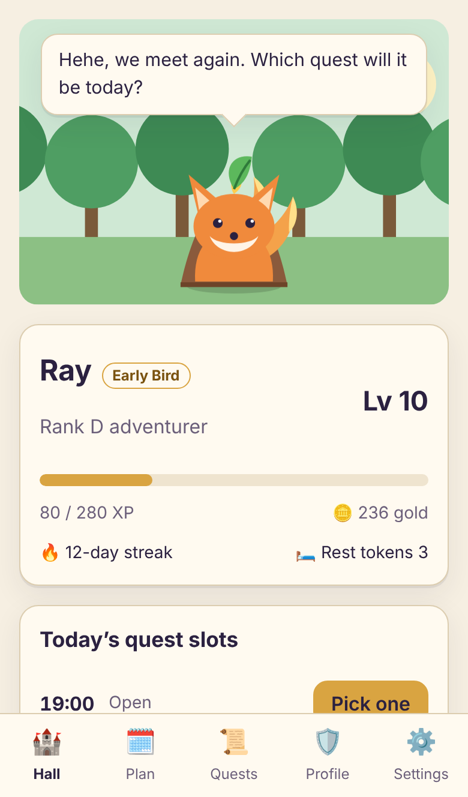
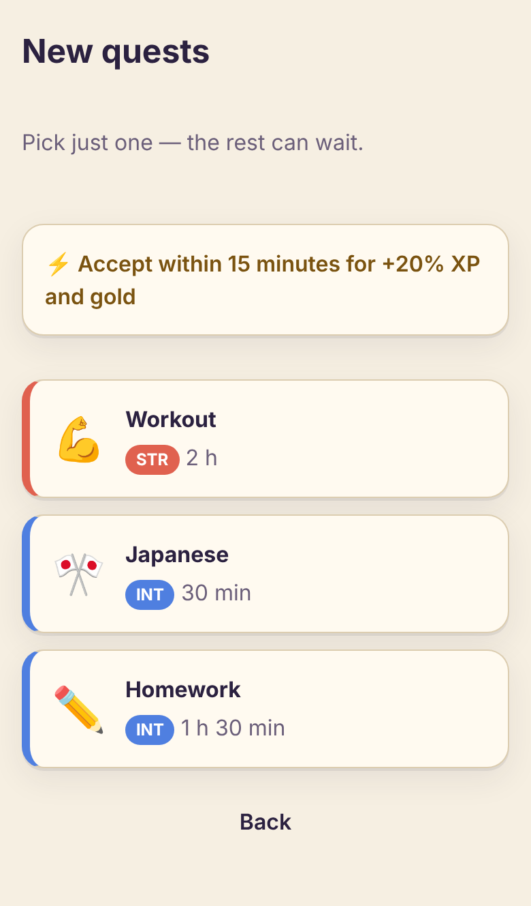
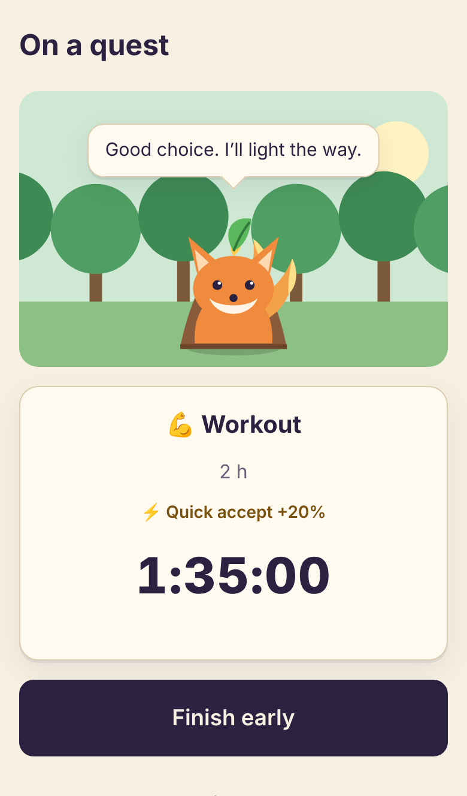
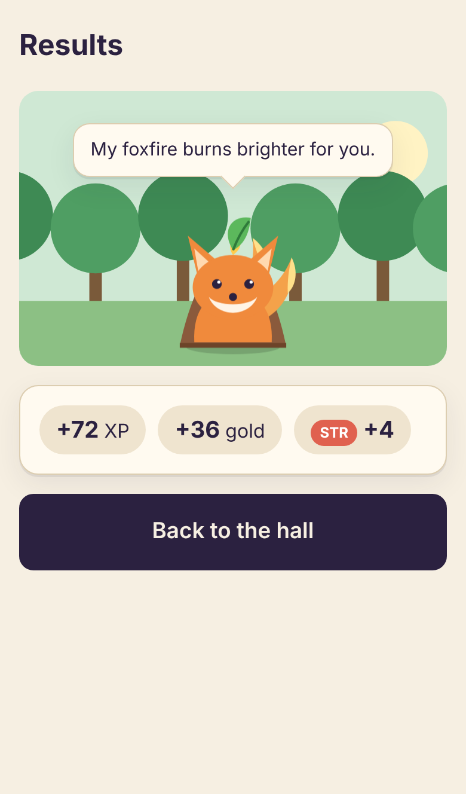
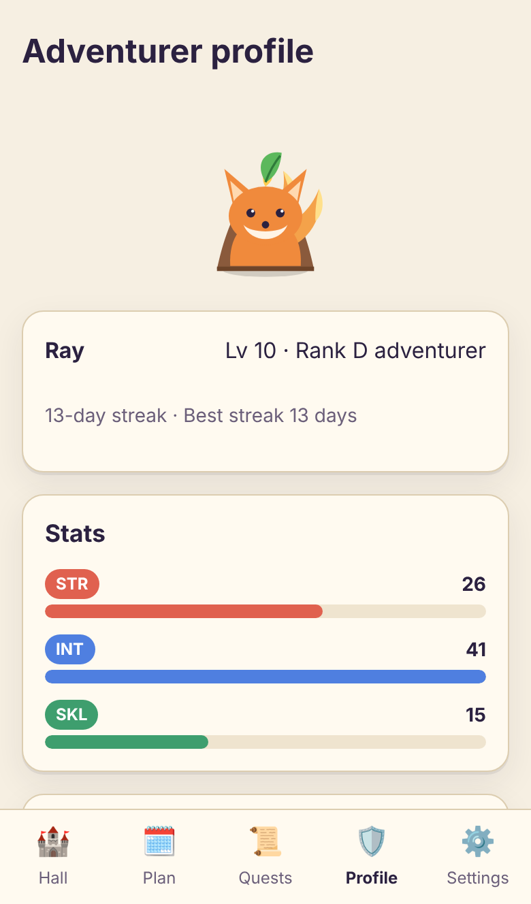
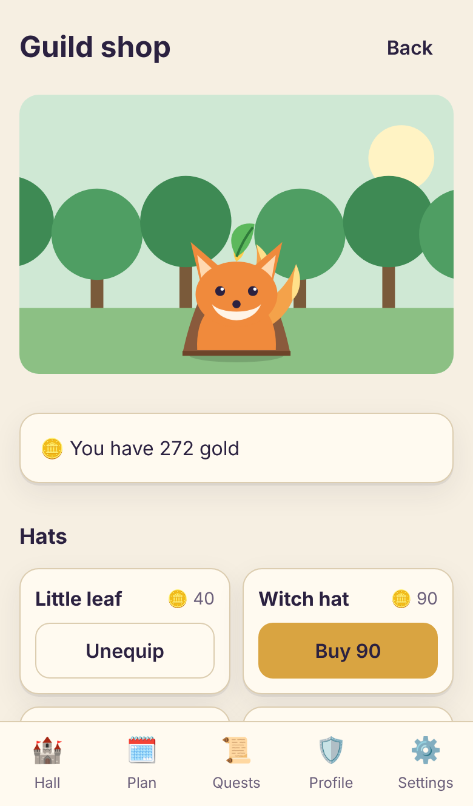
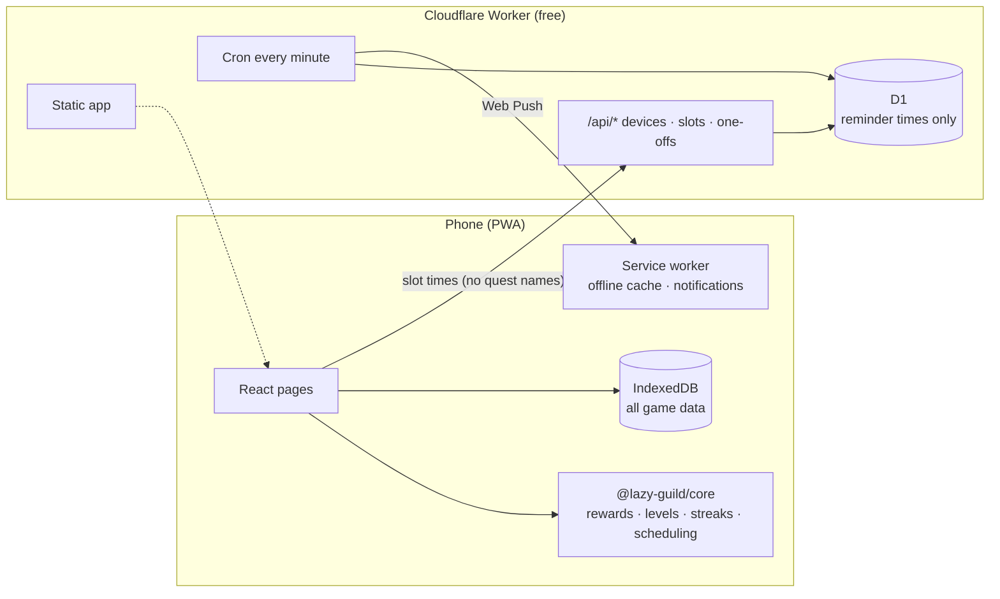

<div align="center">


# Lazy Guild · 懒人公会

**A planner for people who never follow their plans but still want one.**
When the time comes, you only pick one of 2–3 quests, and an isekai adventurers’ guild makes you want to come back every day.

[中文](README.md) · English

</div>

## Why

My plans always die the same two ways:

1. **Too much planned.** I fall behind on day one, the backlog grows, and I stop looking.
2. **I can’t get started.** I know what to do; I just keep putting it off.

So Lazy Guild does the opposite:

- **No full-day to-do list.** Each time slot offers 2–3 candidates. Pick one.
- **No overdue items, no penalties.** Skipping just means no reward this time. Nothing is taken away.
- **Starting matters more than finishing.** Accept within 15 minutes of the notification for +20%; partly done still counts.
- **Slacking is allowed.** Two “inn rest tokens” arrive every Monday and automatically protect your streak on empty days.

## Screenshots

| Guild hall | Pick a quest | On a quest |
|---|---|---|
|  |  |  |
| **Results** | **Profile** | **Guild shop** |
|  |  |  |

## How it works

1. **Weekly plan:** set slots such as “Mon/Wed/Fri 19:00”, each with 2–3 candidate quests (workout / Japanese / math homework).
2. **Notification:** “⚔️ A new quest has arrived!” Tap it to open the quest card and pick one.
3. **On a quest:** a countdown with your companion. Finish early or give up at no cost.
4. **Report back:** another notification when time is up: done / partly / didn’t do it.

**Progression**

- **XP and levels:** 30 XP per hour (capped at 3 hours per quest), ranks F → S.
- **Three stats:** STR / INT / SKL grow with the quest type, so your profile shows what you’ve actually been doing.
- **Companion:** an original slime, foxfire spirit or drakeling that evolves three times with your rank and never gets upset when you slack off.
- **Guild shop:** spend gold on hats, capes, hall backgrounds, titles and rest tokens; some unlock at higher ranks.
- **Badges and milestones:** 15 badges; gold rewards for 3 / 7 / 14 / 30 / 100-day streaks.

Every number lives in one file: [`packages/core/src/balance.ts`](packages/core/src/balance.ts).

**Also**

- Chinese and English, switchable any time
- PWA: add it to your iPhone Home Screen; works offline
- No account: data stays on your device, with export and import
- The push service only knows *when* to ping you, never your quests

## Architecture



| Path | What |
|---|---|
| `packages/core` | Pure TypeScript game rules — no UI, no network, fully unit-tested |
| `apps/web` | React 19 + Vite + vite-plugin-pwa, Dexie (IndexedDB), i18next |
| `apps/push-worker` | Cloudflare Worker + D1 + Cron, Web Push (VAPID, RFC 8291) |
| `docs/` | [Design spec](docs/superpowers/specs/2026-11-04-lazy-guild-design.md), [implementation plan](docs/superpowers/plans/2026-11-04-lazy-guild.md), [deploy](docs/deploy.md), [iPhone guide](docs/iphone-guide.md) |

## Run locally

Requires Node 22 and pnpm 10.

```bash
pnpm install
pnpm dev            # http://localhost:5173
```

```bash
pnpm test           # unit and component tests (core, web, push-worker)
pnpm lint && pnpm typecheck
pnpm e2e            # Playwright end-to-end tests (iPhone viewport, fake clock)
pnpm screenshots    # regenerate docs/screenshots
```

## Deploy

Pushing to `main` runs the tests and deploys to Cloudflare through GitHub Actions. You only add two repository secrets; nothing to install locally. Step by step: [docs/deploy.md](docs/deploy.md).

## License

[MIT](LICENSE). Characters and art are original.
