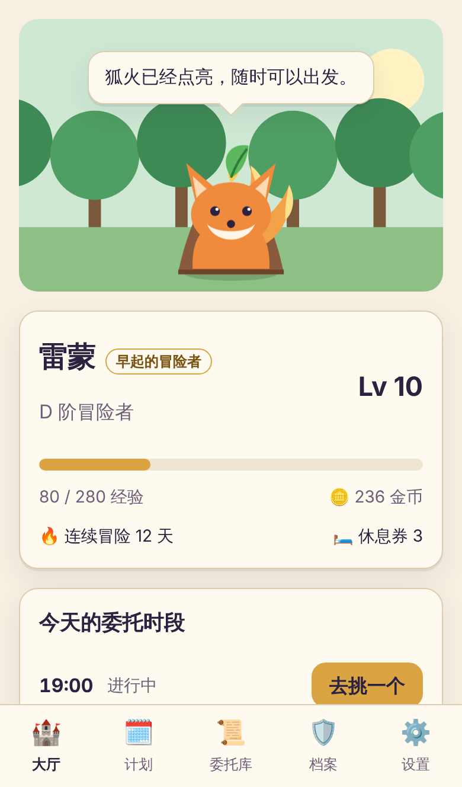
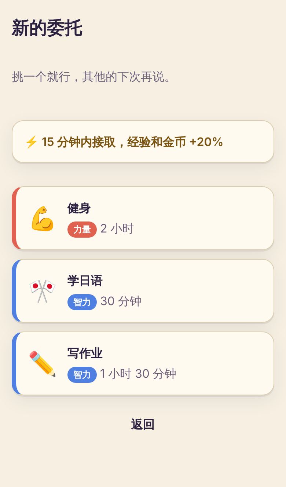
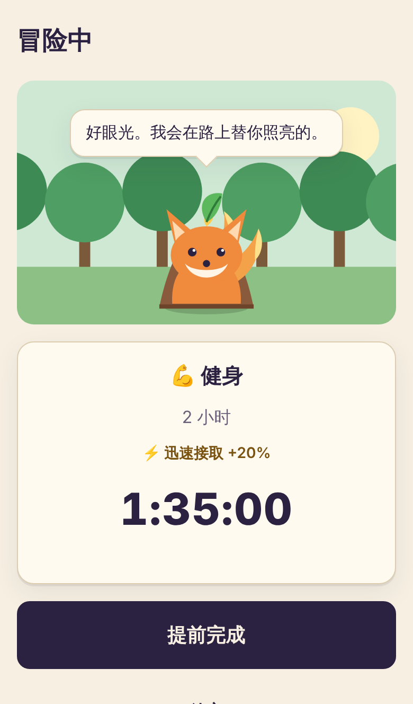
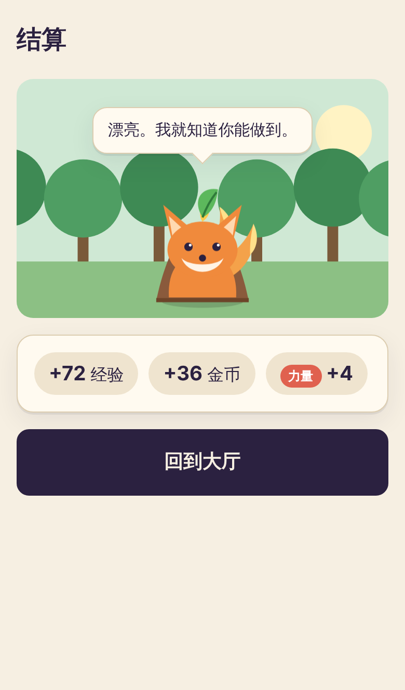
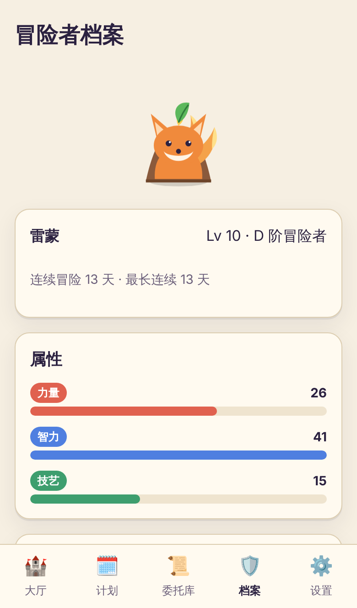
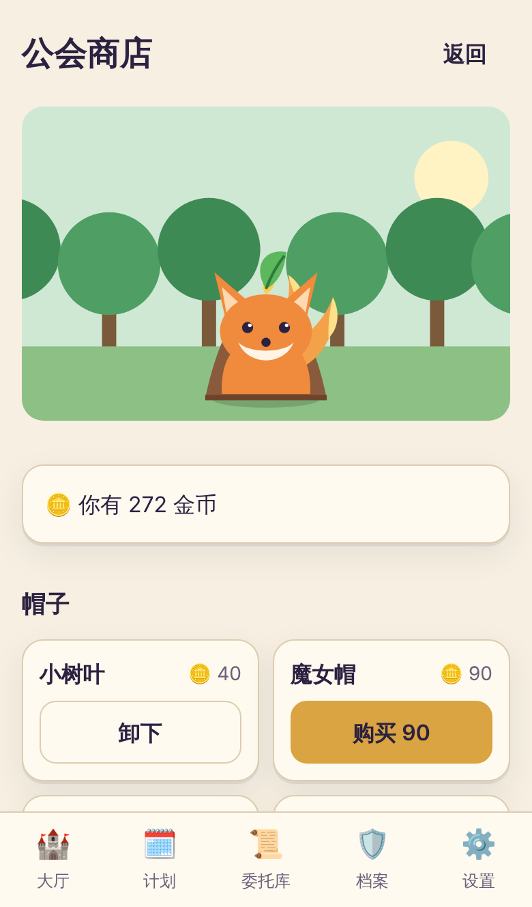
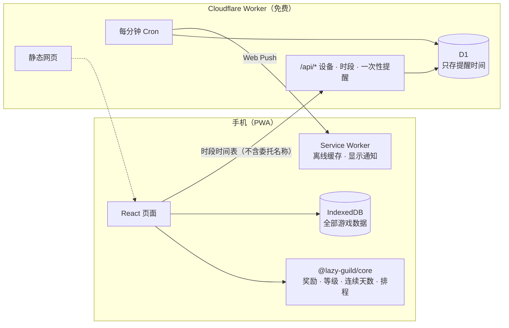

<div align="center">


# 懒人公会 · Lazy Guild

**给“从来不按计划执行，但又想有个计划”的人用的计划 App。**
到点了只让你从 2–3 件事里挑一件，再用异世界冒险者公会的外壳，让你愿意每天打开。

中文 · [English](README.en.md)

</div>

## 为什么做这个

我做计划总是这样失败：

1. **计划太满。** 第一天没跟上，后面越落越多，干脆不看了。
2. **不想开始。** 知道要做，就是一直拖。

所以懒人公会反着来：

- **不给你一整天的清单。** 每个时间点只出 2–3 个候选，挑一个就好。
- **没有逾期，没有惩罚。** 没做就是这次没奖励，什么都不扣。
- **开始比完成更重要。** 通知来了 15 分钟内接取，奖励 +20%；做了一部分也算数。
- **允许摆烂。** 每周自动发 2 张“旅店休息券”，空白的一天会自动用券保住连续天数。

## 截图

| 公会大厅 | 选委托 | 冒险中 |
|---|---|---|
|  |  |  |
| **结算** | **冒险者档案** | **公会商店** |
|  |  |  |

## 怎么玩

1. **每周计划：** 给一周里的某几天设时段，例如“周一、三、五 19:00”，挂 2–3 个候选委托（健身 / 学日语 / 写数学作业）。
2. **到点通知：** “⚔️ 新的委托到了！”，点开就是选择卡片，点一个就开始。
3. **冒险中：** 倒计时，伙伴陪着你。可以提前完成，也可以放弃（不扣任何东西）。
4. **结算：** 时间到了再通知一次，选“完成 / 做了一部分 / 没做”。

**成长系统**

- **经验和等级：** 每小时 30 经验（单次最多按 3 小时算），冒险者阶级从 F 一路升到 S。
- **三项属性：** 力量 / 智力 / 技艺，按委托类型成长，档案页能看出你这段时间在做什么。
- **伙伴：** 原创的史莱姆 / 狐火精灵 / 幼龙，跟着阶级进化三次。它永远不会因为你摆烂而难过。
- **公会商店：** 用金币买帽子、披风、大厅背景、称号和休息券，有些要到一定阶级才解锁。
- **徽章和里程碑：** 15 枚徽章；连续 3 / 7 / 14 / 30 / 100 天有金币奖励。

所有数值都在 [`packages/core/src/balance.ts`](packages/core/src/balance.ts) 一个文件里。

**其他**

- 中英双语，随时切换
- PWA：在 iPhone 上可以添加到主屏幕，离线可用
- 不用注册账号：数据只存在你自己的设备上，可以导出和导入备份
- 推送服务只知道“几点该提醒”，不知道你的委托内容

## 架构



| 目录 | 内容 |
|---|---|
| `packages/core` | 纯 TypeScript 游戏规则，没有界面也没有网络，单元测试全覆盖 |
| `apps/web` | React 19 + Vite + vite-plugin-pwa，Dexie（IndexedDB），i18next |
| `apps/push-worker` | Cloudflare Worker + D1 + Cron，Web Push（VAPID，RFC 8291） |
| `docs/` | [设计文档](docs/superpowers/specs/2026-11-04-lazy-guild-design.md)、[实现计划](docs/superpowers/plans/2026-11-04-lazy-guild.md)、[部署](docs/deploy.md)、[iPhone 指南](docs/iphone-guide.md) |

## 本地运行

需要 Node 22 和 pnpm 10。

```bash
pnpm install
pnpm dev            # http://localhost:5173
```

```bash
pnpm test           # 单元测试和组件测试（core、web、push-worker）
pnpm lint && pnpm typecheck
pnpm e2e            # Playwright 端到端测试（iPhone 尺寸，假时钟）
pnpm screenshots    # 重新生成 docs/screenshots
```

本地联调推送服务见 [docs/deploy.md](docs/deploy.md#本地开发)。

## 部署

推到 `main` 后，GitHub Actions 会自动测试并部署到 Cloudflare。只需要在仓库里放两个 secret，**不用在电脑上装任何东西**。一步步的说明见 [docs/deploy.md](docs/deploy.md)。

## 许可证

[MIT](LICENSE)。角色和美术均为原创。
